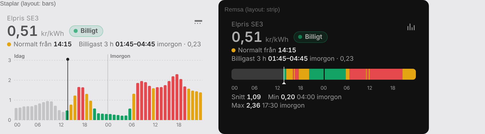

# Nordpool Level Card

[](https://my.home-assistant.io/redirect/marketplace_repository/?owner=em0g&repository=nordpool-level-card&category=plugin)

Ett kompakt Home Assistant-kort för Nord Pool-elpriser med nivåerna **Billigt / Normalt / Dyrt**. Det har staplar eller en tidslinje-remsa, 15-minuters- eller timupplösning och en visuell editor. Med följer ett template-paket som skapar sensorerna kortet och dina automationer läser från.



Kortet visar:
- aktuellt pris och ett nivåchip
- nästa nivåbyte ("Normalt från 14:15")
- det billigaste sammanhängande fönstret framåt ("Billigast 3 h 01:45–04:45 imorgon")
- staplar eller remsa där passerad tid är grå och nu-tiden markeras
- en tooltip vid hover eller tryck (i timläget med de fyra kvartspriserna)

## Innehåll

| Fil | Vad |
|---|---|
| `dist/nordpool-level-card.js` | Kortet `custom:nordpool-level-card` (installeras via Marketplace eller HACS) |
| `package/nordpool_templates.yaml` | Template-paket som skapar `sensor.elpris` och `sensor.elpris_niva` |

## Förutsättning: den officiella Nord Pool-integrationen

Paketet använder Home Assistants **inbyggda Nord Pool-integration** (åtgärden `nordpool.get_prices_for_date`), alltså inte community-integrationen "Nordpool" från HACS/Marketplace.

1. *Inställningar → Enheter och tjänster → + Lägg till integration →* **Nord Pool**.
2. Välj ditt elområde (t.ex. `SE3`) och valuta (`SEK`).

Använd en aktuell Home Assistant-version. 2025.10 eller senare rekommenderas, eftersom Nord Pool har 15-minuterspriser sedan oktober 2025.

## Installation

### Steg 1 – Sensorerna (template-paketet)

1. Kopiera [`package/nordpool_templates.yaml`](package/nordpool_templates.yaml) till `/config/`, alltså samma mapp som `configuration.yaml`.

2. Lägg till `packages:` **inuti ditt befintliga `homeassistant:`-block** i `configuration.yaml`, med två mellanslags indrag som de andra raderna där:
   ```yaml
   homeassistant:
     name: Home
     # ... dina övriga inställningar ...
     packages:
       elpris: !include nordpool_templates.yaml
   ```
   - Skapa inte ett andra `homeassistant:`-block, och lägg inte `packages:` under någon annan nyckel.
   - Ett befintligt `template:` i `configuration.yaml` kan vara kvar, eftersom HA slår ihop det med paketet.

3. Öppna `nordpool_templates.yaml` och ändra inställningarna i det första `variables`-steget:

   | Variabel | Exempel | Beskrivning |
   |---|---|---|
   | `config_entry` | `01K4NGWKRNCEJ43FYVXBS2KGN3` | Nord Pool-integrationens id (se nedan) |
   | `area` | `SE3` | Elområde |
   | `currency` | `SEK` | Valuta |
   | `floor_price` | `0.30` | kr/kWh, alltid **Billigt** under detta |
   | `ceiling_price` | `2.00` | kr/kWh, alltid **Dyrt** över detta |

   **Hitta `config_entry`:** gå till *Utvecklarverktyg → Åtgärder*, välj `nordpool.get_prices_for_date`, välj din Nord Pool-integration i formuläret och växla till YAML-läge. Där står id:t efter `config_entry:`. Det syns också i adressfältet (`…#config_entry=…`) när du öppnar integrationen under *Enheter och tjänster*.

4. Kör *Utvecklarverktyg → YAML → Kontrollera konfigurationen* och starta sedan om Home Assistant.

5. Kontrollera under *Utvecklarverktyg → Tillstånd* att `sensor.elpris` har ett pris och attributet `prices`, och att `sensor.elpris_niva` visar `CHEAP`, `NORMAL` eller `EXPENSIVE`.

Sensorn uppdateras var 15:e minut och vid omstart. Morgondagens priser kommer med automatiskt när Nord Pool publicerar dem, vanligtvis runt 13:00.

### Steg 2 – Kortet (Marketplace)

**Home Assistant 2026.11 eller senare** har HACS inbyggt som **Marketplace**.

[](https://my.home-assistant.io/redirect/marketplace_repository/?owner=em0g&repository=nordpool-level-card&category=plugin)

Klicka på knappen ovan, eller gör så här:

1. Gå till *Inställningar → Marketplace*. Första gången godkänner du varningen om community-innehåll.
2. Sök på **Nordpool Level Card**. Om kortet inte syns i sökningen än väljer du *Lägg till från länk* (uppe till höger), anger `em0g/nordpool-level-card` under *GitHub-länk*, väljer typen **Dashboard** om du får frågan och klickar på *Lägg till*. Det kräver att GitHub är anslutet, och Marketplace ber dig ansluta om det inte är det.
3. Öppna kortets sida, välj *Installera*, kontrollera versionen och välj *Installera* igen.
4. Ladda om webbläsaren (töm gärna cachen).

Marketplace lägger filerna i `www/community/nordpool-level-card/` och lägger själv till resursen `/local/community/nordpool-level-card/nordpool-level-card.js`. Om du hanterar resurser i YAML lägger du i stället till den resurs som installationsdialogen visar.

> Har du tidigare installerat kortet manuellt? Ta då bort resursen `/local/nordpool-level-card.js` (*Inställningar → Kontrollpaneler → ⋮ → Resurser*) och filen i `/config/www/`, så att kortet inte laddas två gånger. Har du installerat det via HACS före 2026.11 flyttas det automatiskt till Marketplace vid uppdateringen.

<details>
<summary>Äldre Home Assistant med HACS (före 2026.11)</summary>

1. Gå till *HACS → ⋮ (uppe till höger) → Anpassade arkiv*.
2. Repository: `https://github.com/em0g/nordpool-level-card`, typ **Dashboard**. Klicka på *Lägg till*.
3. Sök på **Nordpool Level Card** i HACS, öppna det och klicka på *Ladda ned*.
4. Ladda om webbläsaren. HACS lägger själv till resursen `/hacsfiles/nordpool-level-card/nordpool-level-card.js`.
</details>

<details>
<summary>Manuell installation utan Marketplace/HACS</summary>

Kopiera `dist/nordpool-level-card.js` till `/config/www/` och lägg till resursen `/local/nordpool-level-card.js` med typen *JavaScript-modul* under *Inställningar → Kontrollpaneler → ⋮ → Resurser*.
</details>

### Steg 3 – Lägg till kortet

**Visuellt:** *Redigera kontrollpanel → + Lägg till kort*, sök på **Nordpool prisnivå**. Kortet väljer automatiskt `sensor.elpris`. Väljer du i stället entiteten `sensor.elpris` i kortväljaren föreslås kortet under **Community**, som Staplar eller Tidslinje-remsa (Home Assistant 2026.6 eller senare). Allt ställs in i formuläret med live-förhandsvisning bredvid, och editorn sparar bara värden som skiljer sig från standard.

**Eller med YAML:**

```yaml
type: custom:nordpool-level-card
entity: sensor.elpris
title: Elpris SE3
```

## Kortets inställningar

| Nyckel | Standard | Beskrivning |
|---|---|---|
| `entity` | `sensor.elpris` | Sensorn från template-paketet |
| `title` | – | Liten rubrik ovanför priset |
| `layout` | `bars` | `bars` (staplar) eller `strip` (tidslinje-remsa). Ikonen uppe till höger växlar, och valet sparas i webbläsaren |
| `resolution` | `hour` | `hour` (timsnitt, där tooltipen visar de fyra kvartarna) eller `quarter` (alla 15-minuterspriser) |
| `unit` | `kr` | `kr` eller `öre` |
| `decimals` | 2 (kr) / 0 (öre) | Antal decimaler |
| `cheap_window_hours` | `3` | Längd på "Billigast X h"-fönstret. `0` döljer det |
| `show_thresholds` | `false` | Streckade linjer för nivågränserna |
| `height` | `120` | Staplarnas höjd i px |
| `colors` | grön / bärnsten / röd | `{cheap: '#13a365', normal: '#e3a512', expensive: '#e5484d'}` |

## Så räknas nivåerna

Nivåerna räknas på **idag + imorgon** (15-minuterspriser). Igår påverkar dem inte. Innan morgondagens priser har publicerats räknas de bara på idag.

1. Percentil 35 och 70, vilket ger ungefär 35 % billigt, 35 % normalt och 30 % dyrt.
2. **Golv** (`floor_price`): under golvet är det alltid Billigt.
3. **Tak** (`ceiling_price`): över taket är det alltid Dyrt.

```
cheap_max  = min(max(p35, golv), tak)
normal_max = max(min(p70, tak), cheap_max)
pris <= cheap_max → CHEAP, pris <= normal_max → NORMAL, annars EXPENSIVE
```

Därmed blir en jämnt dyr dag inte delvis grön, och en jämnt billig dag inte delvis röd. Kortet färgar med samma gränser som `sensor.elpris_niva`, så kortet och automationerna är alltid överens.

## Automationer

`sensor.elpris_niva` har tillstånden `CHEAP`, `NORMAL` och `EXPENSIVE`. Den fungerar direkt med blueprinten [`Prisnivakontroll_blueprint.yaml`](https://github.com/em0g/Nordpool-templates/blob/main/Prisnivakontroll_blueprint.yaml) om du pekar den mot `sensor.elpris_niva`.

Attributet `next_change` anger när nivån byter nästa gång, t.ex. `{'level': 'EXPENSIVE', 'start': '2026-10-11T16:00:00+02:00'}`.

## Felsökning

| Problem | Lösning |
|---|---|
| `Invalid config for integration X ... 'X.packages.elpris'` | `packages:` ligger under fel nyckel. Flytta det in i `homeassistant:`-blocket |
| `sensor.elpris` är otillgänglig | Kontrollera `config_entry`, `area` och `currency`, och att Nord Pool-integrationen fungerar |
| Kortet visar "Entiteten … hittas inte" | Sensorn är inte skapad än eller heter något annat. Välj rätt sensor i editorn |
| Kortet syns inte i kortväljaren | Ladda om webbläsaren med tömd cache och kontrollera att resursen finns |
| Marketplace ber om omstart efter installationen | Mappen `www` fanns inte när Home Assistant startade. Starta om en gång |

## Uppdateringar

Nya versioner av kortet visas under *Inställningar → Uppdateringar*, tillsammans med release-noterna, när det kommer en ny GitHub-release. Det kan ta några timmar innan en ny release syns. Utan releaser installeras senaste versionen från `main`.

Template-paketet uppdateras inte av Marketplace. Kopiera in den nya filen själv om den ändras.

## Licens och support

[MIT](LICENSE). Kortet är ett community-projekt och granskas inte av Home Assistant-projektet. Rapportera fel och önskemål under [Issues](https://github.com/em0g/nordpool-level-card/issues).

Hur kortet publiceras i Marketplace-katalogen står i [PUBLICERING.md](PUBLICERING.md).
